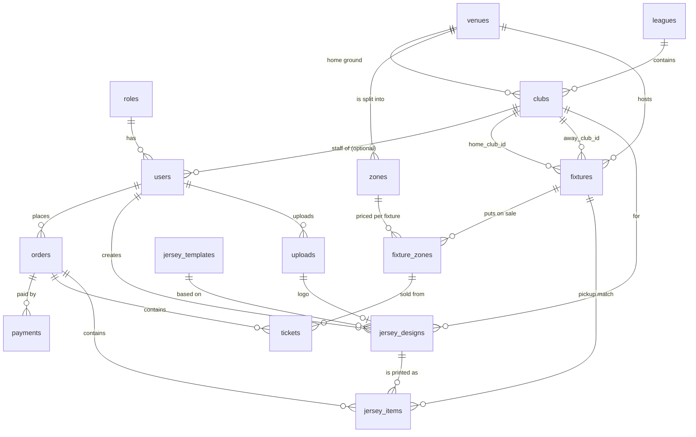

# Database design

PostgreSQL, created from the SQLAlchemy models in `backend/app/models/` (barem 2.01, third normal form). Money is an integer number of bani (1 RON = 100 bani), so there is no floating-point rounding.

## ER diagram

## Why it is in 3NF

- **1NF**: every column holds one atomic value; there are no repeating groups. A fixture's zones are rows in `fixture_zones`, not a list column.
- **2NF**: tables with a composite key have no column that depends on only part of it. `fixture_zones` (key: fixture + zone) holds only `price_bani` and `quota`, which depend on the pair; zone name and capacity live in `zones`.
- **3NF**: no column depends on another non-key column. A club's league and ground are foreign keys, not copied names; the venue's city is stored once in `venues`. A user's role is a foreign key to `roles`, not a string.
- **No derived data**: an order has no stored total (it is the sum of its lines), and the number of seats left is counted from `tickets` against `fixture_zones.quota`.

## Deliberate choices

- **Price snapshots**: `tickets.price_bani` and `jersey_items.price_bani` copy the price at purchase time. This is not a 3NF violation: it records a historical fact (what was paid), which is different from the current `fixture_zones.price_bani` and must not change when a fixture is repriced.
- **A ticket's zone must be on sale**: `tickets (fixture_id, zone_id)` is a composite foreign key to `fixture_zones`, so the database refuses a ticket for a zone that was never put on sale for that fixture.
- **Not enforced by the database** (checked in services instead): a fixture's zones belong to the fixture's venue, and `users.club_id` is set only for staff.
- **Enums** (`fixtures.status`, `orders.status`, `payments.status`, `tickets.status`) are stored as text with the allowed values defined in the model enums.
- **Activity log** is a file, not a table (barem 7.01).
- **Players** are left out until M2 (optional roster).

## Seed data

`python -m app.seed` loads the 14 Liga Florilor 2026/27 clubs from `backend/app/seed/clubs.json` (generated from the HandballManager repo by `backend/tools/build_seed_data.py`), one venue per club, three zones per venue (20 / 50 / 30 % of the capacity), and a generated double round robin of 182 fixtures with three priced zones each. Fixtures, dates and prices are **demo data**.
